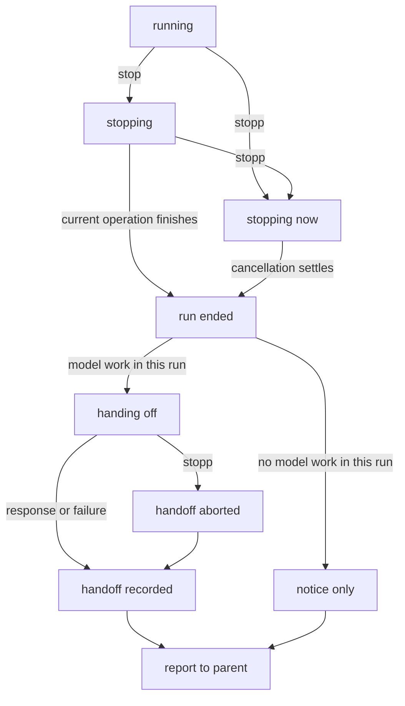

# Stop and handoff design

> [!info] Status
> Implemented and validated offline. Actual provider cache hits still require an explicitly approved live test. The addressed-agent API note describes the user-facing commands.

## Goal

Stopping an investigator should end its research but keep its value. When the user stops it with `/stop` or `/stopp`, a separate handoff call reads the investigator's frozen record and tells the parent what it was asked, what it did, what it found, and what is unfinished. The parent gets usable partial work instead of only "Stopped by the user".

The two commands differ only in how research ends:

| Command | How research ends | Then |
|---|---|---|
| `/stop` | The current model request or tool batch finishes normally. Tool calls proposed in the last response are not executed. | Handoff |
| `/stopp` | The current model request and tools are aborted. Partial model output is kept as incomplete text. | Handoff |

## Decisions

| Question | Decision | Main reason |
|---|---|---|
| Handoff model | The investigator's own recorded model and reasoning level, not the current global config. | Provider caches are per model; the same model is needed to reuse the cache. |
| Tools during handoff | Keep every tool declaration; the instruction strongly asks for no tool calls; tool calls in the response are never executed. No `toolChoice`. | Removing tools changes the cached prefix; on Anthropic, changing `tool_choice` invalidates cached messages. |
| Partial output after `/stopp` | Kept as quoted, incomplete text inside the handoff instruction, never as an assistant message. | Half-written tool calls are invalid assistant content, and the cached prefix stays untouched. |
| Unanswered tool calls | Closed in the projection with "not executed" or "interrupted" results. | Providers need a result for every tool call; no work is invented. |
| Handoff storage | Recorded as an `ET.Handoff` entry in the investigator's record. | A later resume knows what the parent was told, and extends the same cached prefix. |
| Handoff failure | Fall back to an activity log derived from the record. No retries. | The parent always gets something; the log is a pure function and cannot fail like a model call. Retries add delay after the user asked to stop, and a trimmed context would miss the cache. |
| Input during the handoff | The handoff is one more phase of the same run. `/stopp` aborts it (fallback); `/stop` has no effect; messages stay unread; `/status` shows "handing off". | One state machine, and `/stopp` means "stop now" at every moment. |
| Which endings get a handoff | User stops only for now. The code takes the end reason as a parameter. | Ship and measure first. Budget exhaustion is the natural next case; deadlines need time reserved for the handoff first. |
| Cache check | Offline payload test, cache figures in every handoff's details, and one live run with approval. | Each covers a different part: our request, provider behavior over time, and the main case once. |

### Alternatives considered

- **Handoff failure:** returning only the notice loses the work exactly when the provider has trouble. Retrying with a trimmed context breaks the cache and still needs a fallback.
- **Input during the handoff:** an uninterruptible handoff contradicts `/stopp`. Injecting messages into the handoff or resuming after it would mean a stop is no longer final.
- **Scope:** enabling the handoff for every ending now would quietly change the meaning of the budget and the deadline. A per-reason config setting adds combinations to support without a clear need.
- **Cache check:** an offline test alone cannot show provider behavior. A live run alone is one sample and cannot run in CI.

## Run lifecycle



- A stop while queued cancels the run before it starts; there is nothing to summarize, so no handoff call is made.
- If the stop races with an accepted `submit_answer`, the real answer is returned and no handoff is made.
- Parent cancellation, the deadline, and extension shutdown abort research and handoff alike, through the existing run controller. If that happens during the handoff, the fallback is used where a result can still be delivered.

## Data model

All facts stay in the investigator's append-only record (`context_`).

- **`RunEndReason`** gains `user_hard_stopped`, next to the existing `user_stopped`.
- **`ET.RunEnded`** gains an optional `partial`: text and tool calls received before a `/stopp`, kept as data, not as a response.
- **`ET.Handoff`**, recorded after `ET.RunEnded`, is one fact:
  - `trigger`: `/stop` or `/stopp`;
  - `instruction`: the exact text sent;
  - `response`: the model response, when there was one;
  - `outcome`: `summary` or `fallback`;
  - `text`: what the parent receives;
  - `usage`: including `cacheRead` and `cacheWrite`;
  - `error`: why the fallback was used, when it was.

Derived values:

- `status()` looks at the last `ET.RunEnded` and skips a following `ET.Handoff`, so a stopped investigator is `resumable`.
- `usage()` includes the handoff; `turnsInRun()` does not.
- `render()` turns `ET.Handoff` into the exact reporting instruction and valid recorded assistant response. If the response proposes tools, synthetic results close those calls without executing them. Keeping the actual response rather than rewriting it as plain text preserves the next continuation's prefix. Failed or aborted reporting responses are replaced in the projection by an explicitly host-generated fallback message, never a fabricated assistant answer.

## Request and cache contract

The handoff request is the next turn of the stopped investigator:

```text
[system message: worker prompt, repository map, limits, tool declarations]   ← unchanged
[first request and every recorded message, in order]                         ← unchanged
[last research response, and its tool results if any]
[results closing unanswered tool calls: not executed / interrupted]
════════════════════════════════════════════════════════════
INVESTIGATION STOPPED BY THE USER — HANDOFF ONLY
════════════════════════════════════════════════════════════
[user message: trigger, interrupted task, where execution stopped,
 partial output (incomplete), handoff task, no tool calls]
```

To reuse the provider cache, the request must keep:

- the same model and reasoning level, from the investigator's `ET.InvestigationConfig`;
- the same `sessionId`, which Pi's OpenAI providers send as `prompt_cache_key`;
- the same system message and the same tool declarations;
- the recorded messages unchanged and in order, with only new messages at the end;
- no `toolChoice`.

The unchanged prefix is eligible for cache reuse up to the input of the last research request; provider cache availability, retention, transport, and abort behavior determine actual hits. The last response, new tool results, and the handoff message are new tokens, as on any normal turn. On the Codex WebSocket transport, the request can also continue from the previous response by sending only the new input. Providers report cache use unevenly, so a zero `cacheRead` is a warning sign, not proof of a miss.

## Handoff instruction

The instruction is built by a pure function from the record and the trigger. It contains:

- that the user stopped the investigation, and with which command;
- the interrupted task: the current run's request, restated even though it appears earlier;
- where execution stopped, including unexecuted and interrupted tool calls;
- partial output after `/stopp`, quoted and marked as incomplete;
- the task: write a handoff for the parent that separates verified findings with their evidence, uncertainty, and unfinished work; say so plainly if there are no useful findings;
- a strong request not to call any tools and not to continue the investigation.

## Abort scopes

The store keeps one abort controller per stage, `research` and `handoff`. A hard stop makes the reducer return an `abort` command for the stage that is running; the store carries it out.

| Signal | Aborts | Source |
|---|---|---|
| Run controller | Research and handoff | Parent cancellation, deadline, shutdown (existing). |
| `research` stage | Model requests and tools of the run | `/stopp` before the handoff; also used during queue admission. |
| `handoff` stage | The handoff request | `/stopp` during the handoff, or the handoff timeout. |

The worker combines the run signal with the stage signal for each effect. If `stream.result()` returns a response with `stopReason: 'aborted'` after a hard stop, it is treated as a failed effect, not recorded; its content goes into `partial`. If a provider throws instead, the partial content comes from the store's streaming state.

## Budget and config

A new config section `handoff: { timeoutSeconds, maxOutputTokens }`, validated like the others. The handoff's time is also capped by what is left of the run's deadline; when it runs out, the fallback is used. The handoff is not counted against the run's model-request budget; its usage is reported separately. A `config.local.json` override must supply the whole section.

## Fallback

`activityLog(agent)` is a pure function of the record. It lists the interrupted task, the request count, each tool call with its arguments and outcome, and available interrupted output (excluding thinking blocks). Reused call IDs are resolved within their response's tool batch. The fallback is capped at 16,000 characters with an explicit shortening notice; the full record is retained. The parent's result says that the summary could not be produced, and why.

## What the parent receives

```text
richard_the_lionheart = ET.InvestigationAgent('🍃-…') resumable

Stopped by the user with /stopp. Handoff summary — partial work, not a completed investigation:

…summary or activity log…

These user messages were not read and will not resume the investigator:
- "…"
```

Details also hold the handoff outcome and full usage. `input` is uncached input; `cacheReadRatio` is `cacheRead / (input + cacheRead + cacheWrite)`, not `cacheRead / input`. The transcript shows cache-read and uncached-input token counts.

## Implementation plan

| Phase | Step | Work | Checkpoint |
|---|---|---|---|
| Base | 0 | Commit the current `/stop` and `/status` work. | Tests pass, clean tree. |
| Pure core | 1 | `agent.ts`: new end reason, `partial`, `ET.Handoff`; update `status`, `usage`, `turnsInRun`, `render`. | Unit tests on fixed records. |
| Pure core | 2 | New `handoff.ts`: `handoffInstruction`, `handoffContext`, `activityLog`, `handoffResultText`. | Test that `handoffContext` starts with the last research request's messages. |
| Pure core | 3 | `run.ts`: soft and hard stop reasons, `abort` command, `handing_off` phase, `handoff` command, existing `appended` event for the handoff fact, partial output on failure, unread messages kept. | Reducer tests for every stop timing, escalation, no-work runs, and the submit race. |
| Boundaries | 4 | `store.ts`: per-stage abort controllers plus the admission-only signal; carry out `abort`. Admission must remain separate so graceful stops cancel queueing without aborting active research. | Queued stops still cancel admission. |
| Boundaries | 5 | `worker.ts`: stage signals, aborted-response handling, the handoff request (own model, reasoning, `sessionId`, timeout, `maxTokens`, no tool execution), `ET.Handoff` with fallback. | Worker tests with scripted providers. |
| Wiring | 6 | `addressed.ts`, `extension.ts`: `/stopp` parsing and completion, routing, status text, results and reports for both run owners, cache figures in details, unread rule for both reasons. | |
| Wiring | 7 | `config.json`, `config.mjs`: `handoff` section and validation. | Config tests. |
| Proof | 8 | `sdk.test.mjs`: cache contract for `/stop` and `/stopp`; `/stopp` during a model request and a shell tool; `/stopp` during the handoff; handoff failure and timeout; both reporting routes; unread messages; resume after reload with the handoff in context. | All tests pass. |
| Proof | 9 | Update the README, `prompts/parent.md`, and these notes. | |
| Proof | 10 | `npm test`, typecheck, one live run with approval (about three turns, `/stop`, compare `cacheRead` with the previous request's input), commit. | Cache use confirmed or explained. |

## Implementation notes

The existing append-event mechanism records `ET.Handoff`; a separate `handedOff` event was unnecessary. Aborted model requests are counted using an `interruptedModel` flag on the run ending, and their reported usage is retained separately from the reporting call. The concurrency slot remains held through handoff, so reporting cannot bypass the configured concurrency limit. Reporting defaults to 60 seconds and 4,096 output tokens, subject to the original deadline. No live provider calls or commits were made as part of this implementation.

## Risks

- **Aborted streams differ by provider.** Some return an `aborted` response with partial content, others throw. Both paths are handled and tested in step 8.
- **Tool cancellation is cooperative.** A tool that ignores the abort signal delays `/stopp`.
- **Context size.** A long record plus the handoff message may exceed the model's context window; that is a handoff failure, so the fallback is used. The context is never trimmed silently.
- **Cache reporting.** Providers report cache use unevenly; the live check confirms the main case, not every provider.
